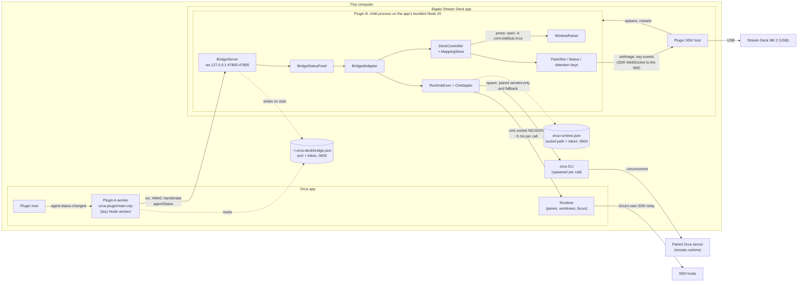
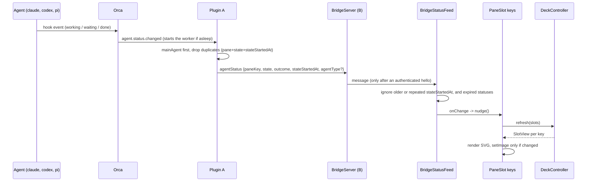
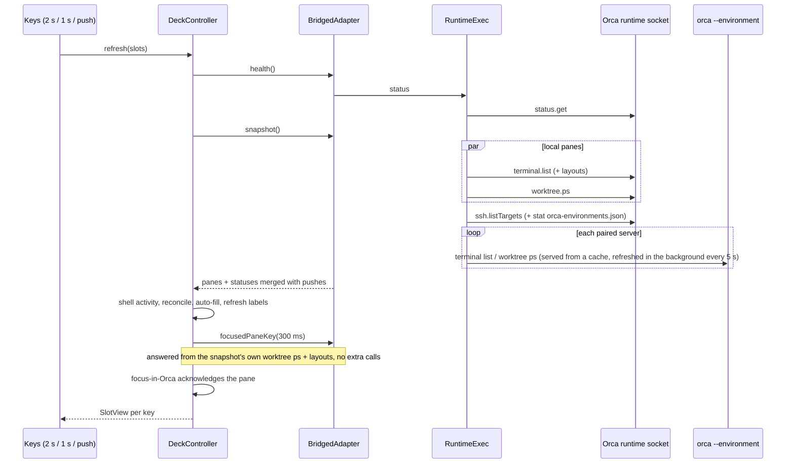
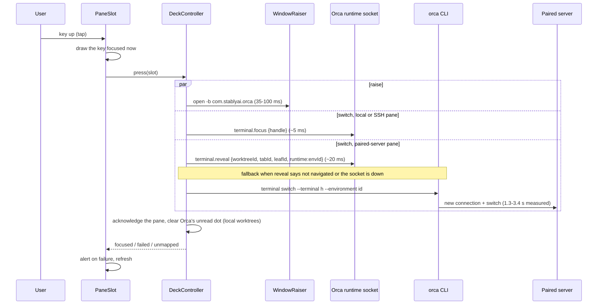
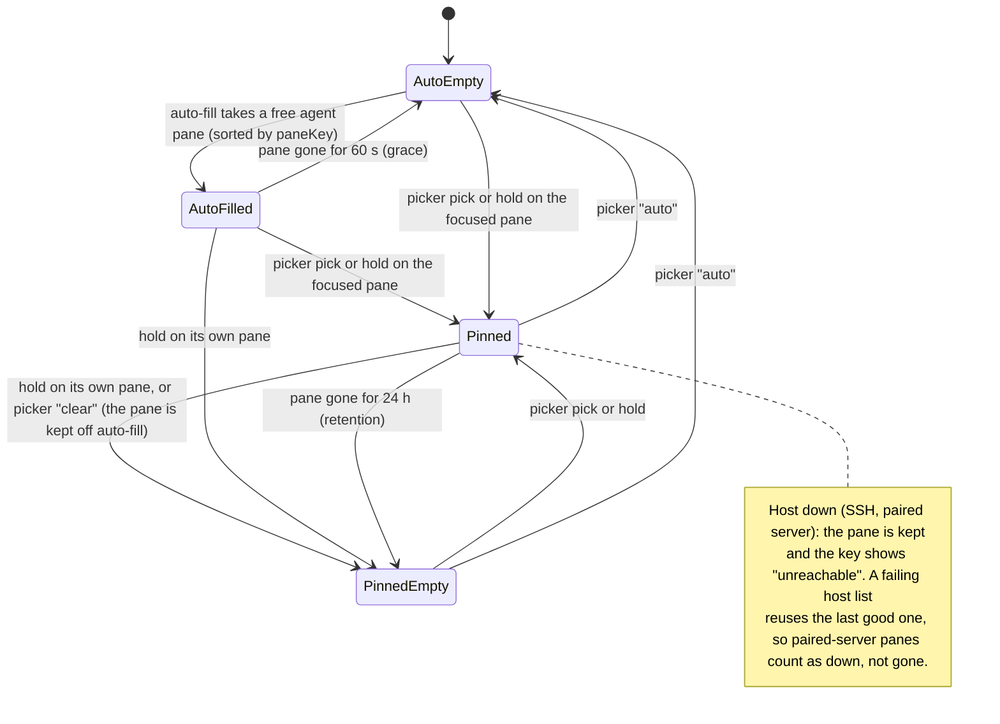

# Architecture: how Orca and the Stream Deck talk

As built, November 2026 (Orca 1.4.248, Elgato Stream Deck app). This page describes what runs today, with timings from a field log of several hours (2026-11-06, incl. sleep/wake and Orca reconnecting to its servers). Upstream limits are in `docs/known-issues.md`.

## Components

Two plugins, one per host app, plus Orca's own runtime:

- **Plugin A** (`orca-plugin/main.mjs`) runs inside Orca as a lazy `trusted-worker`. Orca starts it on the first event and stops it after about 10 minutes without events. It only forwards agent status events to plugin B.
- **Plugin B** (`packages/streamdeck-plugin`) is hosted by the Elgato Stream Deck or OpenDeck app: the app spawns it as a child process on its own bundled Node 20 (`~/Library/Application Support/com.elgato.StreamDeck/NodeJS/20.x/node`), keeps it running while the app runs and restarts it on crash or `streamdeck restart`. B talks to the app over the SDK WebSocket. It owns the keys, the bridge server, the mapping store and all reads and focus calls into Orca.
- **Orca runtime** (in the Orca app) answers B over a unix socket, or a named pipe on Windows. **Paired Orca servers** (environments) are reachable only through the `orca --environment` CLI.



Layering inside B: `packages/core` is pure logic (no `@elgato/*`), every Orca call goes through an adapter. The stack wired in `packages/streamdeck-plugin/src/plugin.ts` is:

`DeckController(BridgedAdapter(CliAdapter(makeRuntimeExec(socket, CLI fallback)), BridgeStatusFeed))`

`CliAdapter` parses CLI-shaped JSON; `makeRuntimeExec` answers those same calls from the runtime socket, so one parser serves both paths.

### Why B also talks to the runtime directly

Plugin A cannot be the only path between Orca and B:

- **A's host API has no pane calls.** A trusted worker gets events plus `notifications`, `storage`, `terminal.sendText` and `workspace.*` host calls. Orca exposes no host call to list panes, read the focused pane or focus one. Those exist only on the runtime socket, so A would have to open the same socket and proxy it: one more hop, same dependency.
- **A cannot show its own panel.** Orca has no host call for it either. The "Agent Deck" status bar button and the shortcut therefore send B an `openPanel` frame, and B calls the runtime's `plugins.open` (`{ pluginKey, panelId }`, what `orca plugin open` does; the local runtime token is the owner's, so it needs no extra grant). B tries `1am.agent-deck`, then `local.agent-deck`, because the install decides the key. If that fails A keeps the deck-side mapping.
- **A is not always running.** Orca starts the worker on an event and stops it after about 10 minutes without events. Nothing outside Orca can start it, so a key press or the 2 s poll after a quiet period would have nobody to answer. B must work while A sleeps; A only makes status changes arrive sooner.
- **A is optional.** With A missing or disabled the deck still works from polling (the Status key's "slow updates").

So the split is: A pushes (events only it receives), B pulls and acts (calls only the runtime answers). The bridge could be a unix socket in `~/.orca-deck` (mode 0600) instead of loopback TCP: no port, no browser reachability, file permissions instead of a token. It stays a WebSocket today because it was the first path verified and it works the same on Windows; switching is a backlog option, not a fix.

Message formats, handshake and versioning are in [bridge-protocol.md](bridge-protocol.md); this file keeps the transport and security details.

## Network surface

Everything listens on loopback or is a local file/socket. Nothing accepts traffic from other machines.

| Endpoint | Owner | Bind / path | Who connects | Auth |
|---|---|---|---|---|
| Bridge WebSocket | Plugin B (`packages/adapter-bridge/src/server.ts`) | `127.0.0.1`, first free port of 47800-47809 (`ORCA_DECK_BRIDGE_PORTS`, a comma list where `0` means any free port, replaces the range for tests; a malformed value is ignored with one log line) | Plugin A only | 32-byte token from `bridge.json` (0600 in a 0700 dir, rotated per start; refused when a symlink, foreign-owned or readable by others. On Windows, which has no mode bits, only the symlink check applies and the user profile's ACL keeps it private), never sent: A and B prove it to each other with HMAC-SHA256 over two 16-byte nonces and a direction label before A sends anything; upgrades with an `Origin` header (browsers), a `Host` other than `127.0.0.1:<port>` (DNS rebinding) or from a non-loopback address are refused (401); frames over 256 KiB close the socket on both sides; 2 s to finish the handshake, at most 2 pending connections (a new one evicts the oldest) |
| Orca runtime socket | Orca | unix socket `o-<pid>-<id>.sock` (0600); named pipe `\\.\pipe\orca-<pid>-<id>` on Windows | Plugin B, `orca` CLI | `authToken` from `orca-runtime.json` (0600) in every request; rotated on each Orca start. Never logged. Windows pipe names are visible to every local account, so with Orca stopped and a stale `orca-runtime.json` another account could open the old name and receive a token that no longer works. |
| Orca paired-device WebSocket | Orca | `ws://127.0.0.1:6768` | Not used by us (needs an E2EE handshake) | Orca's |
| Stream Deck SDK WebSocket | Elgato app | `127.0.0.1`, port passed to B at launch | Plugin B (client) | Registration UUID from the app |
| Paired server | Remote Orca | over the network, via Orca's own transport | `orca --environment` CLI | Orca's device pairing; `orca-environments.json` holds the tokens, B only `stat`s it |

## Status push (plugin A to the keys)



A merges at snapshot time (`BridgedAdapter.snapshot`): a push wins over the polled row when it is newer, polled `toolName` and `agentType` are kept when the state is the same, and a push for a pane that has had no Orca agent row for two polls is expired for good (Orca sends no event when a row disappears). After a reconnect A replays its last state per pane; replays never move a pane backwards and never revive an expired status.

## Refresh loop

Pane keys refresh every 2 s and on every push; the Status and Attention keys repaint every 1 s. Refreshes are queued in `DeckController.refresh`, and a Status/Attention refresh rides on one that is running or ran in the last 1.5 s, so Orca sees one round at a time.



Steady state for local and SSH panes is 4 socket calls per refresh and zero process spawns. When the socket is unusable the same calls go to the CLI (about 150-230 ms each) and the Status key shows "slow link (CLI)".

## Key press

A tap (released before the 1 s hold) runs `DeckController.press`. The key is redrawn as focused at once, then the pane switch and the window raise run in parallel.



The pressed key stays highlighted while Orca reports no focus (it does not publish focus for a paired server), until Orca reports you in another pane. A pane that is missing for now (a paired server still reconnecting after wake) cannot be switched; the press still raises Orca and the key shows an alert.

## Plugin A and the bridge connection

```mermaid
sequenceDiagram
  participant B as Plugin B
  participant D as bridge.json
  participant O as Orca
  participant A as Plugin A worker
  B->>B: listen 127.0.0.1:47800 (next port if busy)
  B->>D: {v, port, token, pid} mode 0600
  O->>A: start worker on the first event
  A->>D: read port + token (private file only)
  A->>B: WebSocket upgrade (no Origin, Host 127.0.0.1:port)
  B-->>A: challenge {nonceB}
  A->>B: auth {nonceA, mac: HMAC(token, "auth" + nonceB + nonceA)}
  B-->>A: proof {mac: HMAC(token, "proof" + nonceA + nonceB)}
  Note over A: A sends nothing more until the proof checks out (5 s deadline)
  A->>B: hello {orcaVersion, pluginVersion}
  B-->>A: helloAck {deck: connected, devices}
  A->>B: replay last agentStatus per pane
  Note over A,B: ~10 min without events: Orca stops the worker, B keeps the last state ("asleep", not an error)
  B--xA: Elgato app restarts B: new port/token
  A->>D: re-read after a failed connect, backoff 1 s to 30 s
  Note over A,D: connected: A re-reads bridge.json every 5 s; another pid/port/token (a newer B) drops the socket and A connects to it
  Note over B: the host quits: B sees its parent pid change or vanish (checked every 2 s), closes the bridge, removes bridge.json only if it still names itself, exits
```

Both Stream Deck apps swap freely: the SDK reports no closed host socket, so B polls its parent pid (`watchHost`, `packages/streamdeck-plugin/src/host-watch.ts`) and exits when the host is gone, instead of staying as an orphan on its bridge port. A newer B just overwrites `bridge.json`; the older one, once it exits, leaves that file alone (`BridgeServer.stop` checks pid and token).

## Slot mapping lifecycle

Auto-fill is off in the Stream Deck plugin for now (`DeckController` option `autofill: false` in `packages/streamdeck-plugin/src/plugin.ts`): slots hold pinned panes only, an auto slot stays empty, and a pane an earlier version auto-filled is taken off. The diagram shows the full lifecycle with auto-fill on.

A slot is one Pane key (Stream Deck action context). Mappings live in the plugin's global settings, keyed by `paneKey` (`<tabId>:<leafId>`, stable across Orca restarts). Terminal handles are looked up fresh on every refresh and never stored.



## Latency budget (field log 2026-11-06)

| Step | Measured | Notes |
|---|---|---|
| Window raise (`open -b`, macOS) | 35-100 ms | No permission needed |
| Focus, local pane (socket) | 40-100 ms incl. raise | |
| Focus, paired-server pane | ~20 ms via `terminal.reveal` (probe); 1.3-3.4 s on the CLI fallback | The CLI fallback is a spawn plus a new connection to the remote runtime |
| Refresh, steady state | well under 1 s (not logged) | Slow refreshes (>1 s) are logged with a per-phase split |
| First refresh after start | 2-5.7 s | Cold paired-server CLI calls; later ones are served from the cache |
| First read after wake | ~1.8 s | Socket health call while Orca wakes |
| Paired-server status age | up to ~7 s | 5 s cache plus the 2 s poll, unless plugin A pushes it |

## Platform decisions (macOS, Windows, Linux)

One helper per concern, all pure and tested with `path.win32`/`path.posix` (`packages/core/src/paths.ts`); `main.mjs` mirrors the two it needs and a test keeps the mirror equal.

| Concern | Decision |
|---|---|
| Own files (`bridge.json`, `mappings.json`, plugin A's log) | `deckDataDir`: `%APPDATA%\orca-deck` on Windows, `~/.orca-deck` elsewhere; the same for plugin B, plugin A and the diagnostics script |
| File trust | `isPrivateStat`: owner and mode 0600 checked on POSIX, not on Windows (modes mean nothing; the profile folder is the user's). One implementation for the bridge file, the mappings file and Orca's runtime file |
| Orca runtime socket | Taken from the transports Orca writes into `orca-runtime.json`: `unix` on macOS and Linux, `named-pipe` (`\\.\pipe\orca-<id>-<kind>`) on Windows (Orca's `runtime-rpc-socket-metadata`). The folder of that file on Windows (`%APPDATA%\orca`) is device only |
| Orca CLI | Launcher name per platform: `orca.cmd`, `orca-ide` (Linux desktops), `orca` (`orcaCliName`). Node refuses to run a `.cmd` without a shell, so `spawnPlan` runs it through `cmd.exe` with an allowlist for the program path and every argument (no quotes or `& | < > ^ % !`), and throws otherwise; everything else is spawned directly. The CLI is only the degraded fallback and the plugin probe. Device only: where Windows installs `orca.cmd` (`ORCA_BIN` or the PATH entry from Orca's "register CLI") |
| PATH | Joined with `path.delimiter`; the Unix fallback dirs are not added on Windows |
| Window raise | macOS `open -b`, Linux X11 tools; Windows (#175) and Wayland are a no-op that reports why, and the plugin logs it once |
| Test shims | `orca` and `open` are node scripts everywhere; Windows runs them through a `.cmd` launcher |

## Logs

- Plugin B: `~/Library/Application Support/com.elgato.StreamDeck/Plugins/pl.1am.orca-agent-deck.sdPlugin/logs/pl.1am.orca-agent-deck.0.log` (newest). Press lines read `press slot=<id> -> <result> <ms> (local|ssh|env)`.
- Plugin A: `~/.orca-deck/plugin-a.log` (Windows `%APPDATA%\orca-deck\plugin-a.log`); "Agent Deck: Show status" in Orca's command palette writes a status summary there. See `docs/install.md` for the full list.
- Neither log ever contains terminal content, pane previews or tokens.
