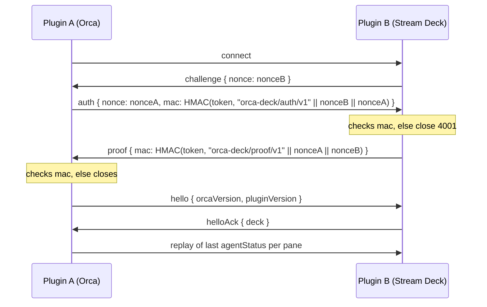

# Bridge protocol (plugin A <-> plugin B)

Reference for the messages exchanged between **A** (the Orca plugin, a trusted worker inside Orca) and **B** (the Stream Deck plugin). Source of truth: `packages/adapter-bridge/src/protocol.ts` (zod schemas) and `orca-plugin/main.mjs` (A's side). A test (`protocol-doc.test.ts`) fails when the message types in `protocol.ts` and the tables below differ. Transport, ports, socket paths and file modes live in [architecture.md](architecture.md#network-surface).

## Model

- **A pushes, B owns state and acts.** A forwards events only it receives (agent status, workspace changes, pairing commands). B holds the status model, the mapping store and the deck, and answers with acks, pairing feedback and snapshot requests.
- B is the server (long-lived), A is the client and may come and go: Orca stops an idle worker and restarts it on the next event, so a disconnect is normal and B keeps the last known state.
- Every message is a UTF-8 JSON object with `v` (protocol major, number) and `type` (string). One connection carries one A at a time; a newer authenticated connection replaces the old one (close code 4003).
- The transport only has to deliver whole messages in order. See [Transport binding](#transport-binding).

## Handshake

- Nonces are 16 random bytes as 32 lowercase hex characters. Anything else is refused.
- `mac` is HMAC-SHA256 keyed with the token, over the direction label and the two nonces concatenated as strings, hex encoded. The labels differ per direction so an answer cannot be reflected or spliced into another session.
- **Nothing is sent before proof.** A sends only `auth` until B's `proof` verified. B accepts nothing but `auth` (then `hello`) from an unauthenticated peer.
- The token comes from the discovery file B writes (rotated on every B start, read by A before each connect). It is never sent on the wire.
- **Timeouts and failure:**

| Side | Limit | On failure |
| --- | --- | --- |
| A | 5 s from connect to a verified `proof` (`HANDSHAKE_MS`) | logs the cause (no challenge: older or foreign peer; no proof; bad proof), closes, retries with backoff (1 s doubling to 30 s) |
| B | 2 s from accept to `hello` (`HELLO_MS`) | closes 4000 |
| B | wrong or missing `mac`, wrong first message, malformed message before auth | closes 4001 |
| B | `hello` without the challenge handshake (A older than B) | closes 4001 and records `outdatedPeerAt` so the deck can say "update the Orca plugin" |

## Messages A -> B

Fields marked `?` are optional, `null` marks nullable. All carry `v` and `type`.

| type | Fields | Meaning |
| --- | --- | --- |
| `hello` | `orcaVersion: string`, `pluginVersion: string`, `minor?: int` | First message after proof. B answers `helloAck`. `minor` is A's protocol minor (absent = 0). |
| `auth` | `nonce: string` (32 hex), `mac: string` | Answer to `challenge`, see Handshake. |
| `agentStatus` | `paneKey: string`, `workspaceId: string`, `state: string`, `outcome?: string \| null`, `stateStartedAt: number` (ms epoch), `receivedAt: number` (ms epoch), `agentType?: string \| null` | An agent in a pane changed state. `agentType` is the harness id (claude, codex, pi) when Orca's event has it. |
| `workspace` | `event: "created" \| "removed"`, `workspaceId: string`, `path: string` | A workspace (worktree) appeared or went away. `path` is `""` when Orca gave none. |
| `pairRequest` | `requestId: string`, `pane: { paneKey: string, worktreeId: string } \| null` | User asked to map a pane to a key. `null` means B resolves the focused pane. |
| `unmapRequest` | `requestId: string`, `pane: { paneKey, worktreeId } \| null` | Same shape, remove the mapping. |
| `pairCancel` | `requestId: string` | Cancel a pending `pairRequest`. |
| `requestDeck` | none | Minor 1. Asks B to send `deckState` now (the Orca panel opened). |
| `assignKey` | `requestId: string`, `key: int >= 1`, `replace: boolean`, `paneKey?: string`, `hostId?: string` | Minor 1. A choice in the key picker of the Orca panel: B puts the pane `paneKey` names (one of `deckState.panes`, on host `hostId` when given: tab and leaf ids repeat across hosts) on that key, or the focused pane when there is none, like pairing followed by a tap, and answers `pairResult` (`noSuchPane` when `paneKey` is not a pane Orca lists any more). A key that shows a pane needs `replace: true`, else `pairResult` says `occupied`. B checks that the key exists on the deck it shows (`noSuchKey`), never A. |
| `unmapKey` | `requestId: string`, `key: int >= 1` | Minor 1. Empties a key; B answers `pairResult` with `action: "unmapped"`. |
| `openPanel` | `requestId: string`, `panelId: string` | Minor 2. Asks B to show the Orca panel `panelId` (`deck`) in the sidebar: B calls the runtime's `plugins.open` (host-admin, what `orca plugin open` does), which a worker cannot. B answers `openPanelResult`. |

## Messages B -> A

| type | Fields | Meaning |
| --- | --- | --- |
| `challenge` | `nonce: string` (32 hex) | First message on every connection. |
| `proof` | `mac: string` | B proves it knows the token, see Handshake. |
| `helloAck` | `deck: { connected: boolean, devices: { model: string, keys: number }[] }`, `minor?: int` | Handshake done; reports whether the Stream Deck app is connected and which devices it sees. `minor` is B's protocol minor (absent = 0). |
| `requestSnapshot` | none | A should replay its last `agentStatus` per pane. |
| `pairState` | `requestId: string`, `state: string`, `pane?: { label: string }` | Pairing progress for the on-Orca feedback (for example `waitingForKey`). `state` is an open string. |
| `pairResult` | `requestId: string`, then either `ok: true, slot: { page: int >= 1, index: int >= 1 }, action?: "mapped" \| "moved" \| "unmapped"` or `ok: false, reason: "timeout" \| "cancelled" \| "noFocusedPane" \| "deckOffline" \| "noSuchKey" \| "occupied" \| "noSuchPane"` | Final outcome. `slot` is 1-based, row-major. `action` and the last three reasons are minor 1. |
| `deckState` | `connected: boolean`, `model: string \| null`, `cols: int`, `rows: int`, `keys: { key: int >= 1, label: string, state: string, mapped: boolean }[]` | Minor 1. The deck the Orca panel draws: sent after `hello` to an A of minor 1 or more, on every change (checked once a second) and on `requestDeck`. `key` is 1-based, row-major, the number "Assign here" shows. `label` is the pane's name on the key, `""` when empty. `panes?` lists what the key picker offers, at most 200, the focused pane first: `{ paneKey, hostId?, label, detail, host?, agent: string \| null, state, remote: boolean, focused: boolean, onKey?: int }` (`label` is repo and branch or the pane title, `detail` the pane title and tab, `host` the host name of a remote pane, `onKey` the key the pane is on; `hostId` goes back in `assignKey`). An older B sends none. |
| `openPanelResult` | `requestId: string`, `ok: boolean`, `reason?: "unavailable" \| "refused"` | Minor 2. `ok: true`: Orca shows the panel. `unavailable`: Orca's runtime cannot be reached; `refused`: it did not open the panel (A then falls back to the deck-only mapping). |

## Semantics

- **State source.** A derives `state` from `mainAgent.state` of Orca's `agent.status.changed` event and falls back to the top-level `state` (which can be stale; Pi reports only the top level). `outcome`, `stateStartedAt` and `agentType` come from `mainAgent` as well; `stateStartedAt` falls back to `receivedAt`.
- **Dedup.** Orca delivers one transition two or three times. A drops an event whose `(paneKey, state, stateStartedAt)` equals the last one it forwarded for that pane.
- **Replay.** After `helloAck` and on `requestSnapshot` A re-sends its last `agentStatus` per pane (at most 500 panes, least recently updated dropped first). B treats a replay as ordinary input: it never moves a pane backwards and never revives an expired status.
- **Ordering and loss.** Messages are ordered within a connection. A message sent while not connected is dropped (`send` returns false); the replay on the next connection covers status, not `workspace` or pairing messages.
- **Unknown types.** After auth, B ignores a message that fails validation (logged as "malformed", no content) and A hands unknown B types to its handler, which ignores them. Before auth, any invalid message closes the connection.

## Versioning

- `PROTOCOL_VERSION` (`v`) is the major version, currently 1. A message with another `v` throws `UnsupportedVersionError`; B closes the connection with **4002** and logs the received version. The Stream Deck plugin and the Orca plugin are released together; a breaking change bumps `v` and both sides ship in the same release (the Property Inspector shows "Update Agent Deck for Orca" when they disagree).
- **Adding an optional field needs no bump.** zod objects strip unknown keys, so an old receiver ignores a field it does not know; a new receiver treats the field as optional. Precedent: `agentType` on `agentStatus`. Removing or renaming a field, changing a meaning, or adding a required field is breaking.
- **Minor version.** `PROTOCOL_MINOR` (currently 2) counts additive features within a major. Each side tells its minor in `hello` / `helloAck`; a peer that sends none speaks minor 0 (v0.2.x). Minor 1 adds `requestDeck`, `assignKey`, `unmapKey`, `deckState` and the extra `pairResult` fields. Minor 2 adds `openPanel` and `openPanelResult`: A sends `openPanel` only to a B of minor 2 or more, an older B keeps the deck-only mapping. A sender only uses a feature the peer's minor has: B sends `deckState` only to an A of minor 1 or more, and the Orca panel says "Update the Stream Deck plugin" when B's `helloAck` has no minor 1 or `deckState` does not arrive within 2 s of `hello`. A v0.2.1 peer ignores the new frames (B: "malformed message ignored" after auth, A: unknown types go to a handler that ignores them), so the old pair keeps working. New frames are accepted only from a proven peer, like all others.
- Changing the handshake is breaking; changing only the transport binding is not.

## Limits

- At most **256 KiB** per message (`MAX_MESSAGE` in A, `MAX_PAYLOAD` in B). Real messages are well under 1 KiB. An oversized message closes the connection on both sides.
- At most 2 unauthenticated connections are held by B; a new one evicts the oldest (close 4004).
- Close codes used by B: 4000 hello timeout, 4001 unauthorized, 4002 unsupported version, 4003 replaced, 4004 evicted.

## Transport binding

The only part of this document that depends on the channel.

| Channel | Framing |
| --- | --- |
| WebSocket on loopback (today) | one JSON message per text frame; close codes above are WebSocket close codes |
| Unix socket / named pipe (planned, task #153) | one JSON message per line (NDJSON); the close codes become a log entry and a closed socket |
